# GlucoGuide, screen by screen

These screens follow one person, Alex, who was just told he has prediabetes, through his first day and the weeks after. Every screenshot is from the live app, including the AI responses.

**Try it yourself:** [gluco-guide-mu.vercel.app](https://gluco-guide-mu.vercel.app)

1. [Getting started](#getting-started)
2. [Logging a meal](#logging-a-meal)
3. [Home after lunch](#home-after-lunch)
4. [Groceries](#groceries)
5. [Fiber and water](#fiber-and-water)
6. [Exercise, stress, and supplements](#exercise-stress-and-supplements)
7. [Weeks later](#weeks-later)
8. [Four languages](#four-languages)

## Getting started

Before sign-up, the app asks for a language, greeting the person in their phone's language. Alex then picks what to track, and the app builds a calorie plan from his height, weight, age, and activity. Day one opens with three small steps instead of a blank screen.

   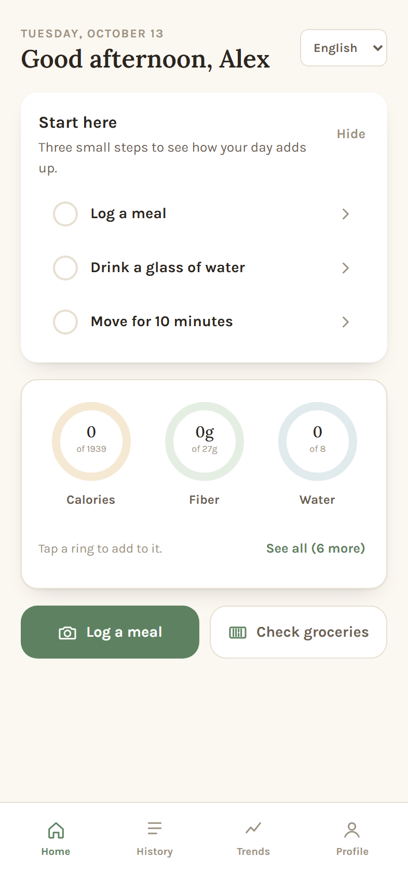

## Logging a meal

Alex photographs his lunch. The AI names the dish, estimates the portion, flags ingredients to watch (⚠), scores the meal from refined carbs to fiber and protein, and suggests one swap for next time. When a dish could be two things, it asks before adding the meal. Alex can also search about 326,000 foods from the OpenNutrition database or type in a nutrition label.

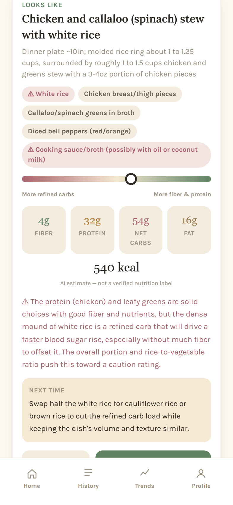 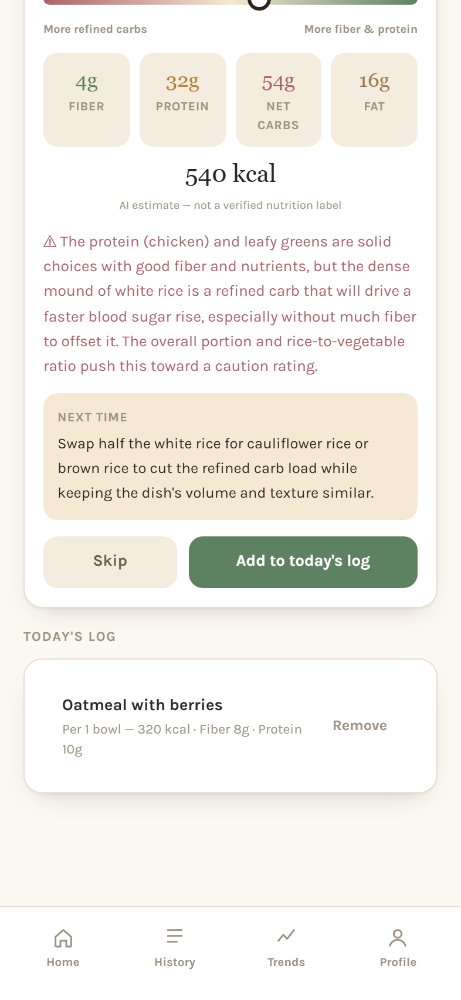 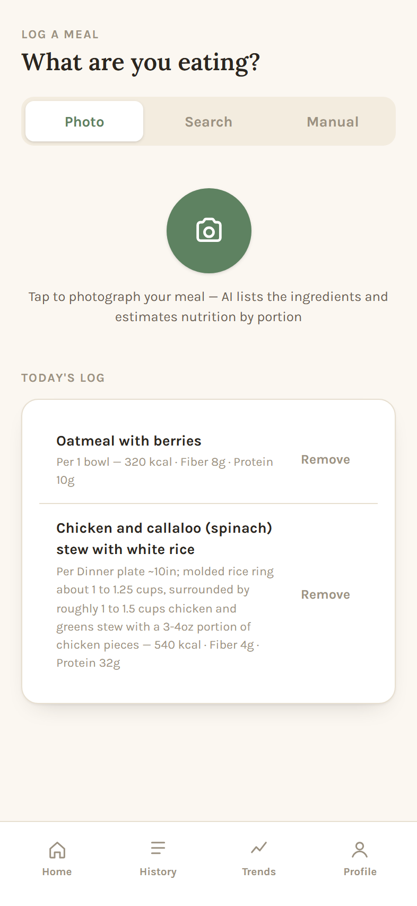 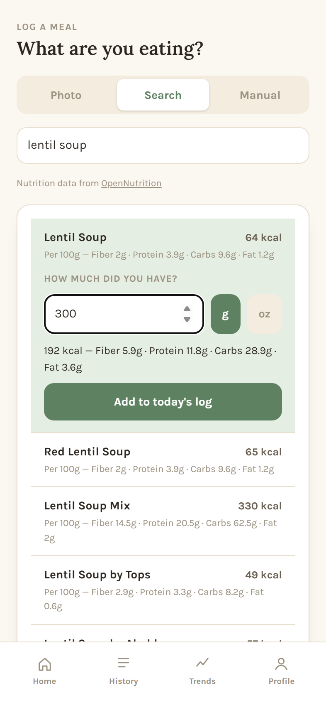 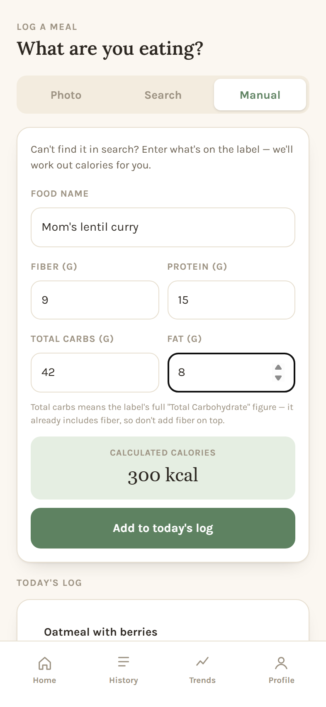

## Home after lunch

Lunch fills the rings, and the AI reads Alex's day so far and writes him a short note. Tapping any ring opens the screen where it's logged.

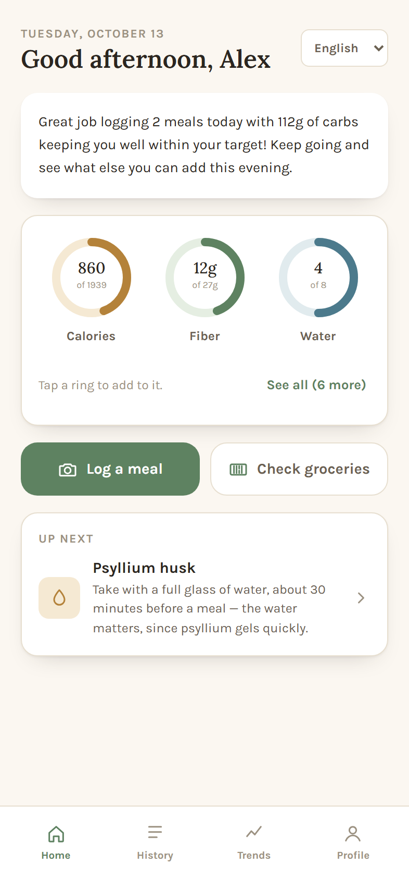 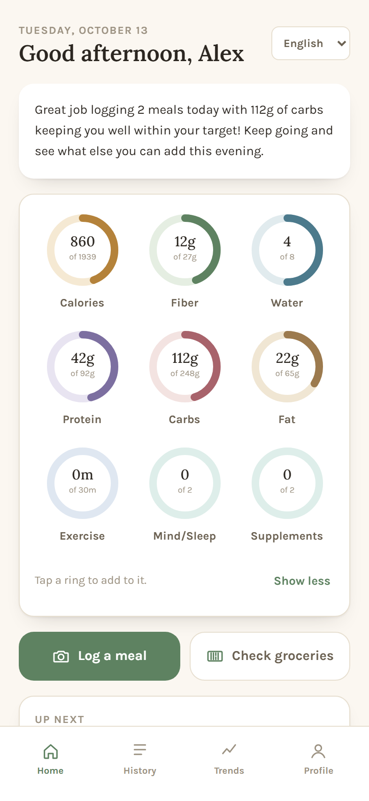

## Groceries

The AI reviews Alex's whole shopping list. It flags items to limit, links to healthier homemade recipes, and guesses what he plans to cook from the items together. Here it spots a chicken, bean, and spinach bowl and suggests brown or cauliflower rice instead of white. History shows whether his lists are getting healthier, and Favorites adds his usual staples in one tap.

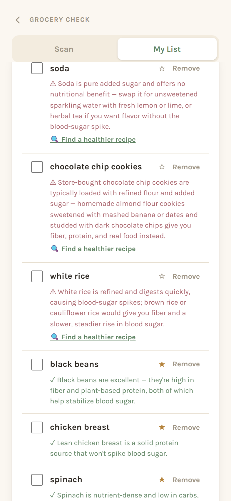 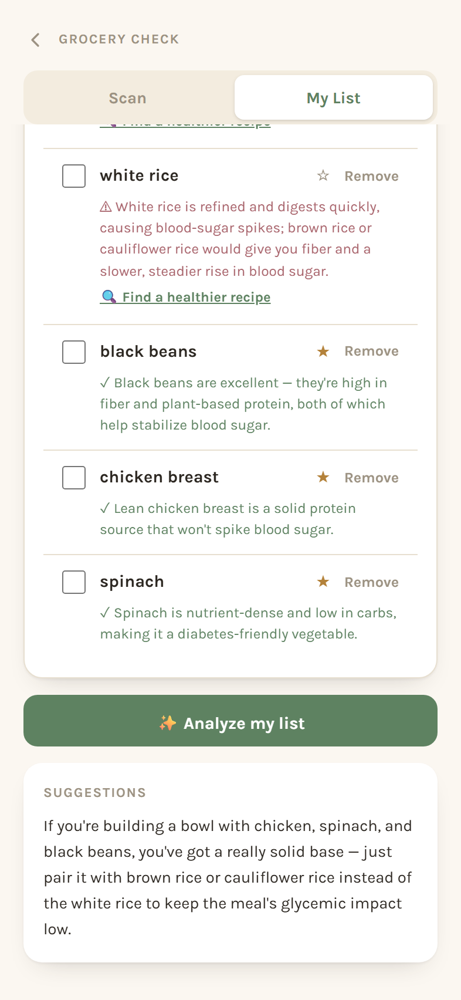 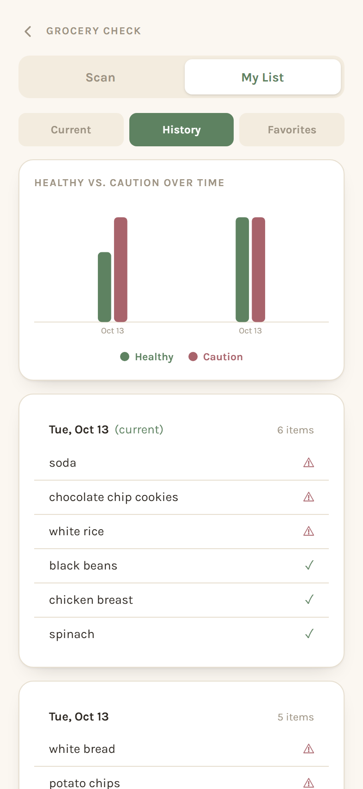 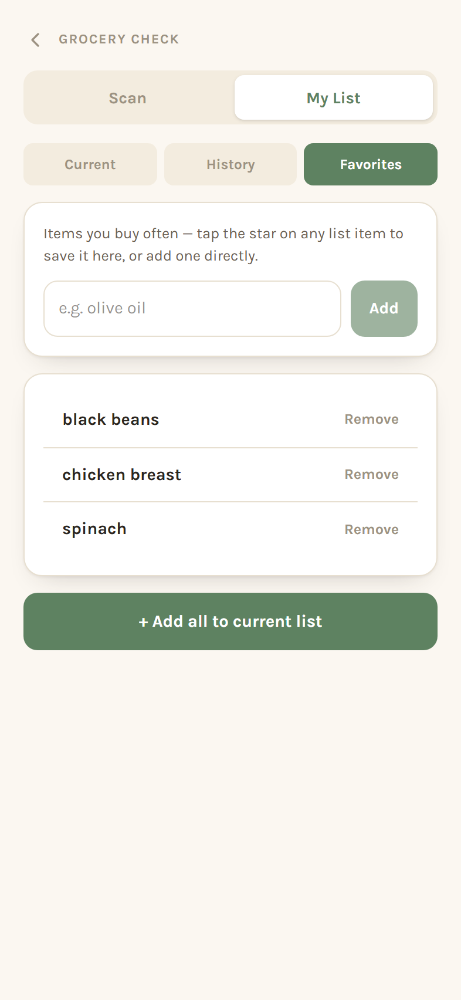

## Fiber and water

Fiber slows how fast sugar reaches the blood, so the app suggests three fiber supplements and explains how each one helps and when to take it. Alex can pick his own brand instead, and the AI looks it up. Water sits on the same screen because fiber needs water to work comfortably.

 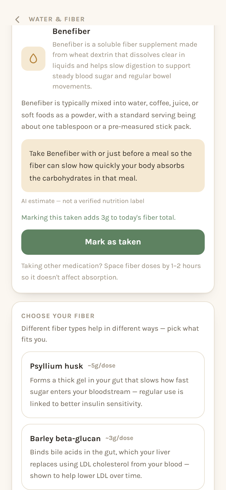

## Exercise, stress, and supplements

Exercise counts toward the CDC Diabetes Prevention Program goal of 150 minutes a week. Stress and poor sleep raise blood sugar too, so the app tracks both. The supplements screen explains common deficiencies linked to insulin resistance, such as vitamin D and magnesium, and lets Alex track his own.

 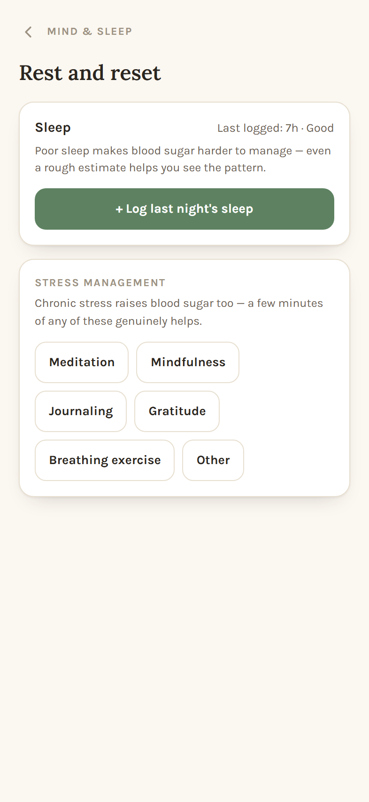 

## Weeks later

Lab results are charted against the normal range, with a plain-language note on the trend. Fourteen-day charts show each habit against its goal, and the AI summary points out what's going well and suggests what to work on next. Alex can also set a weight goal and choose a safe pace.

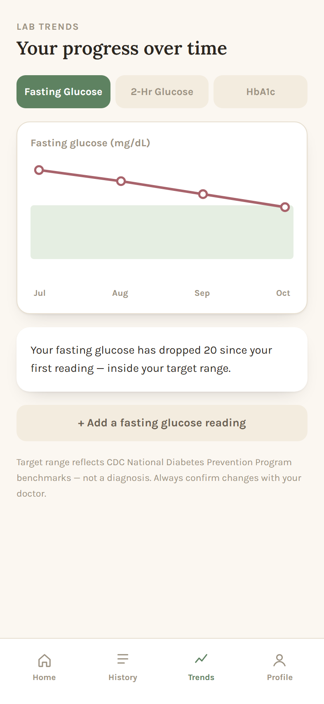  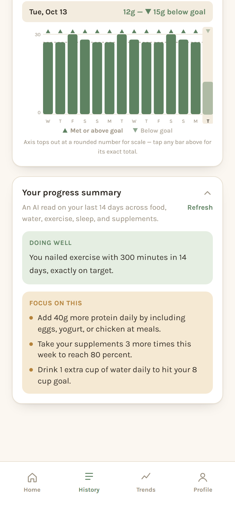 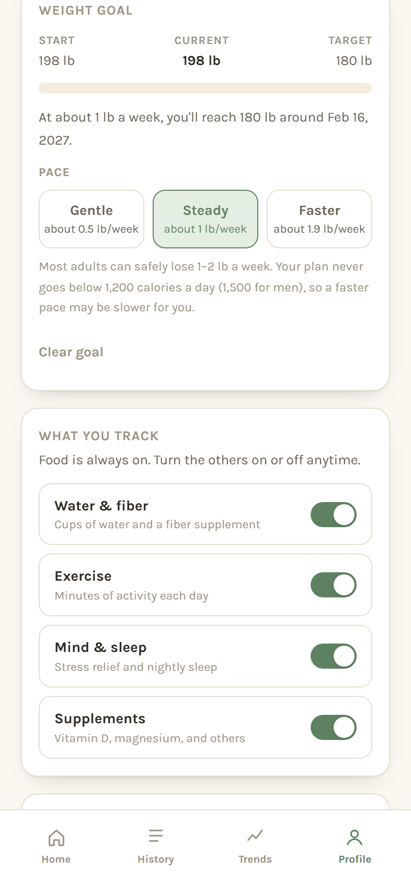

## Four languages

The whole app, including every AI response, works in English, Spanish, Simplified Chinese, and Hindi.

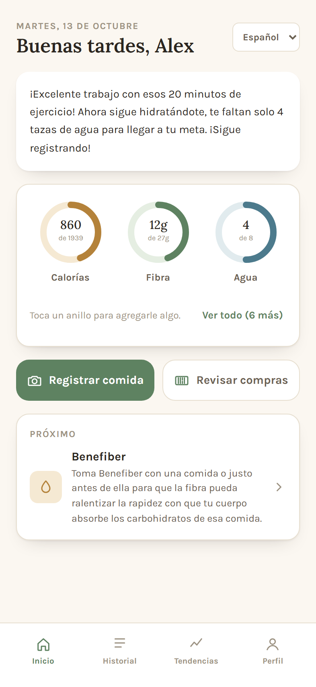 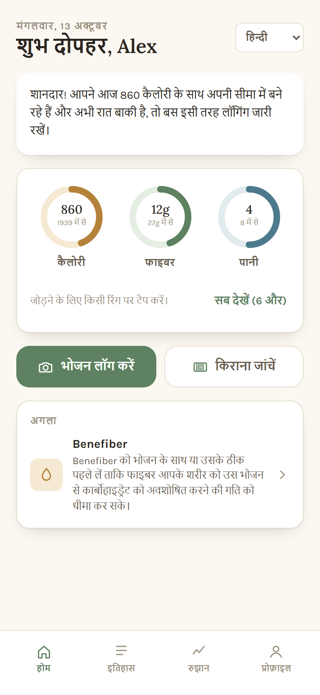 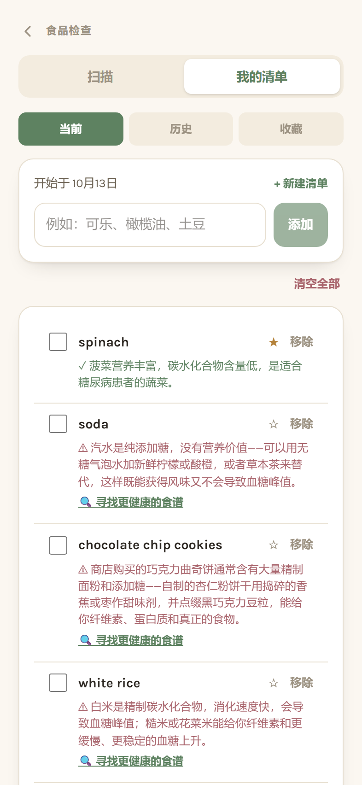

---

Screenshots use a demo account with sample data. Meal photo: "[Chicken curry and rice](https://commons.wikimedia.org/wiki/File:Chicken_curry_and_rice.jpg)" by E4024, [CC BY-SA 4.0](https://creativecommons.org/licenses/by-sa/4.0/).
